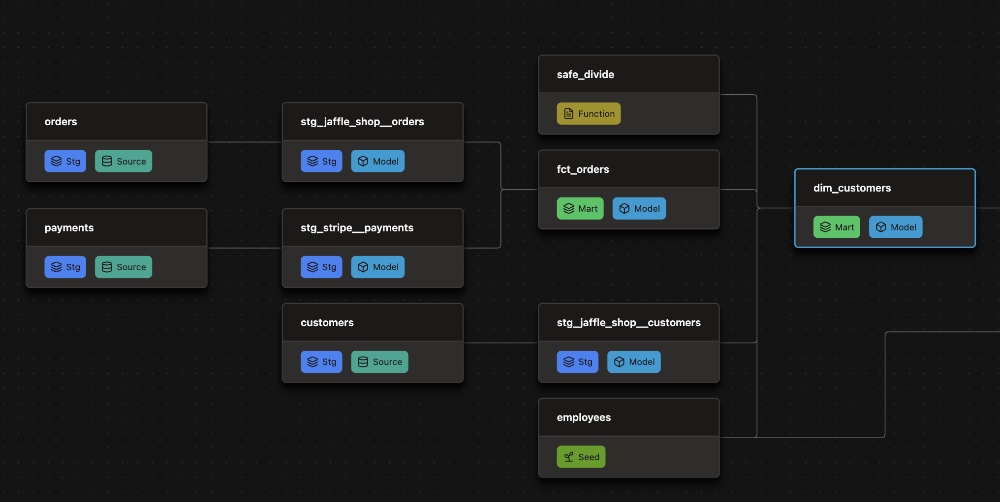

# dbt on Databricks: Jaffle Shop analytics pipeline

An end-to-end dbt project on **Databricks Unity Catalog** built with the **dbt Fusion engine**. It
models orders, customers, and payments for the fictional Jaffle Shop. The data is small, so the
focus is on the engineering around it: layered modeling, contracts, versioned models, incremental
loads, custom tests, unit tests, a Python model, SQL UDFs, environment isolation, and slim CI on
GitHub Actions.

Each feature was added through its own pull request, so `git log` shows the project being built
one step at a time.

---

## Table of contents

- [What this project demonstrates](#what-this-project-demonstrates)
- [Architecture and lineage](#architecture-and-lineage)
- [Models](#models)
- [Testing strategy](#testing-strategy)
- [Environments: catalog-per-developer](#environments-catalog-per-developer)
- [CI/CD](#cicd)
- [Macros and utilities](#macros-and-utilities)
- [Repository layout](#repository-layout)
- [Reproducing this project](#reproducing-this-project)
- [Troubleshooting](#troubleshooting)

---

## What this project demonstrates

| Area | Implementation |
|---|---|
| Layered modeling | `staging` (views) → `intermediate` (tables) → `marts` (tables), each in its own schema |
| Model contracts | `fct_orders` and `dim_customers` enforce column names and types, with named `primary_key`, `not_null`, and `check` constraints |
| Model versioning | `dim_customers` v1 (legacy, deprecated and disabled) and v2 (current); `audit_helper` compares the two |
| Incremental models | `fct_orders` uses `merge` on `order_id` with a reusable lookback-window macro |
| Python models | `is_holiday.py` flags US federal holidays with pandas on Databricks serverless compute |
| SQL UDFs | `safe_divide` and `is_positive_int` are defined as dbt `functions` and deployed to the warehouse |
| Dynamic SQL | `int_orders_pivoted` queries the distinct order statuses at compile time and pivots them into columns |
| Custom generic tests | `greater_than_zero`, plus an override of the built-in `not_null` that also catches sentinel values by data type |
| Unit tests | Inline dict and CSV-fixture unit tests, including mocking `current_timestamp()` so date math is deterministic |
| Governance | `dbt_meta_testing` requires a `unique`/`not_null` test and documentation on every model; CI enforces it |
| Source freshness | `warn_after`/`error_after` thresholds on the raw sources |
| Snapshots | SCD Type 2 `orders_snapshot` using the `check` strategy, defined in YAML |
| Environment isolation | Each developer gets their own catalog (`analytics_<user>`); prod uses `analytics` |
| Slim CI | PRs lint, build, and test only `state:modified+`, compared against a manifest published from `main` |
| Linting | SQLFluff config (Databricks dialect, dbt templater) enforced in CI with `dbt lint` |

---

## Architecture and lineage



*Upstream lineage of `dim_customers` from `dbt docs`, with the model-layer lens on: three sources →
staging models → `fct_orders`, plus the `employees` seed and the `safe_divide` UDF. Not shown:
`int_orders_pivoted` (reads the same staging models), the `date_spine` → `is_holiday` calendar
branch, and `orders_snapshot`.*

**Sources** live in a separate `raw` catalog (`raw.jaffle_shop.*`, `raw.stripe.*`). The source
data is the set of CSVs in [`data/`](data/).

---

## Models

### Staging: one-to-one with sources, light cleanup

| Model | What it does |
|---|---|
| `stg_jaffle_shop__customers` | Renames `id` → `customer_id` and builds a title-cased `customer_name` |
| `stg_jaffle_shop__orders` | Renames columns, maps `return_pending` → `returned` and `pending` → `placed` (keeping `order_status_raw`), and computes `days_since_last_order` |
| `stg_stripe__payments` | Renames columns and converts `amount` from cents to dollars |

### Intermediate: reusable building blocks

| Model | What it does |
|---|---|
| `date_spine` | Daily calendar from 2019-01-01 through the end of next year (`dbt_utils.date_spine`) |
| `is_holiday` | **Python model.** Reads `date_spine` into pandas and adds an `is_holiday` flag using `USFederalHolidayCalendar`. Runs on Databricks serverless compute |
| `int_orders_pivoted` | One row per `order_date`, with one column per order status holding the total of successful payments. The status list comes from a `run_query` at compile time, so a new status adds a new column without any code change |

### Marts: consumer-facing, contract-enforced

| Model | Grain | Notes |
|---|---|---|
| `fct_orders` | one row per order | **Incremental** (`merge` on `order_id`, `on_schema_change: fail`). `lifetime_value` = sum of successful payments. Enforced contract with a named primary key |
| `dim_customers` (v2) | one row per customer | Order counts, first and most recent order dates, `lifetime_value`, and `average_order_value` (calculated with the `safe_divide` UDF). Joined to the `employees` seed. Enforced contract with a `check (customer_id > 0)` constraint |
| `dim_customers` (v1) | — | Legacy version that reads straight from sources. Kept to show the versioning workflow, with `deprecation_date: 2026-01-01` and `enabled: false` |

Column descriptions that repeat across models are defined once as doc blocks in
[`models/docs.md`](models/docs.md) and referenced with `{{ doc(...) }}`.

---

## Testing strategy

Tests are layered from the raw sources up to the marts:

1. **Source tests.** `unique`/`not_null` on source keys, `accepted_values` on status columns, and
   source **freshness** thresholds on `orders` and `payments`.
2. **Generic tests.** `unique`, `not_null`, `relationships` (orders → customers, dim_customers →
   employees), and `accepted_values` on the cleaned `order_status`.
3. **Custom generic tests** in [`tests/generic/`](tests/generic/):
   - `greater_than_zero`: fails on negative values (used on `fct_orders.lifetime_value`).
   - `not_null` **override**: replaces dbt's built-in test. It reads the column's actual data type
     and also fails on placeholder values that are null in practice: `1900-01-01` for
     dates/timestamps and `'0000'` for strings. You can add more per column with `date_sentinels`,
     `string_sentinels`, or `number_sentinels`.
4. **Singular test.** `assert_positive_total_for_payments` checks that no order has a negative
   total payment amount.
5. **Unit tests** in
   [`_stg_jaffle_shop_unit_tests.yml`](models/staging/jaffle_shop/_stg_jaffle_shop_unit_tests.yml):
   - order-status cleanup logic (inline `dict` fixtures)
   - `days_since_last_order`, with `dbt.current_timestamp` overridden to a fixed date
   - title-casing of `customer_name` from mixed-case input (CSV fixtures in `tests/fixtures/`)
6. **Contracts.** The column names and data types of mart models are checked at build time,
   before any data is written.

Two project-level settings in `dbt_project.yml` apply to all of these:
- **Failing rows are stored** (`data_tests: +store_failures: true`), so you can query a failed
  test's rows in the warehouse.
- **Unit tests are skipped in prod** (`+enabled: "{{ var('dbt_env', 'dev') != 'prod' }}"`).

---

## Environments: catalog-per-developer

Instead of the usual `dbt_<user>_marts` schema-prefix pattern, each environment gets its own
**Unity Catalog catalog**. Layer schema names stay the same everywhere:

| Profile `schema` | Resolved catalog | Example relation |
|---|---|---|
| `default` (prod) | `analytics` | `analytics.marts.fct_orders` |
| anything else, e.g. `acepeda` (dev/CI) | `analytics_<schema>` | `analytics_acepeda.marts.fct_orders` |

Two macros implement this:
- [`generate_database_name.sql`](macros/generate_database_name.sql) picks the catalog: `analytics`
  when `target.schema == 'default'`, otherwise `analytics_<target.schema>`.
- [`generate_schema_name.sql`](macros/generate_schema_name.sql) returns the plain layer schema
  (`staging`, `intermediate`, `marts`, `seeds`, `snapshots`, `functions`) with no environment
  prefix.

This keeps dev data fully separate from prod, and SQL you copy out of dev runs unchanged against
prod once you switch the catalog.

**Dev builds are capped by date.** The [`date_window`](macros/date_window.sql) macro handles this:
- **When `target.name == 'dev'`:** filters to the last `lookback_days` days (default 3500). You
  can change this with `--vars '{"lookback_days": 30}'`.
- **Incremental runs on other targets:** uses the same number of days as a lookback from
  `max(column)` in the existing table, to pick up late-arriving rows.
- **Full refreshes on other targets:** applies no filter.

---

## CI/CD

Two GitHub Actions workflows in [`.github/workflows/`](.github/workflows/) implement slim CI.
Both install dbt Fusion and connect to Databricks using
[`ci/profiles.yml`](ci/profiles.yml), which reads everything from repository secrets.

**`dbt-publish-manifest.yml`** runs on push to `main`:
1. Runs `dbt deps` and `dbt source freshness`. Freshness is non-blocking.
2. Runs `dbt parse` to produce `manifest.json` and `sources.json`.
3. Uploads both as the `main-manifest` artifact, which the PR workflow uses as its baseline.

**`dbt-slim-ci.yml`** runs on every pull request:
1. Downloads `main`'s manifest. If none exists yet, it falls back to building everything.
2. Resolves the models in `state:modified+`.
3. **Lints** only the modified model files with `dbt lint`, using [`.sqlfluff`](.sqlfluff).
4. **Builds and tests** only `state:modified+`.
5. Runs `dbt_meta_testing`'s `required_tests` and `required_docs` on those models. Every model
   needs at least one `unique`/`not_null` test and full documentation (configured under
   `+meta` in `dbt_project.yml`).

Production runs are not defined in this repo. The project only needs a target whose profile
`schema` is `default`.

---

## Macros and utilities

| Macro | Purpose |
|---|---|
| `date_window(column, lookback_days, default_date)` | Date filter that depends on the environment and run type (see above) |
| `cents_to_dollars(column, decimal=2)` | Rounded cents → dollars conversion |
| `union_table_by_prefix(database, schema, prefix, columns)` | `UNION ALL` of every table in a schema that matches a prefix (uses `dbt_utils.get_relations_by_prefix`) |
| `find_orphaned_tables(database, schemas)` | Compares `information_schema` with the dbt manifest and **logs** `DROP` statements for warehouse objects that no model, seed, or snapshot defines. It never runs the drops. It also accounts for the unversioned pointer view that Fusion creates for the latest model version |
| `find_datatypes(relation)` | Prints a relation's live columns as YAML `- name / data_type` entries, ready to paste into a schema file |
| `find_all_datatypes()` | Prints live column types for every model, seed, and snapshot in the current target. Useful for spotting undocumented columns |

Run the audit helpers with `dbt run-operation`, for example:

```bash
dbt run-operation find_orphaned_tables --args '{database: analytics}'
dbt run-operation find_all_datatypes
```

**UDFs** ([`functions/`](functions/)) are deployed to the `functions` schema and called from
models with `{{ function('safe_divide') }}(...)`.

**Analyses** ([`analysis/`](analysis/)) hold scratch work: `codegen` commands for generating
model YAML, and an `audit_helper` comparison of `dim_customers` v1 and v2.

**Packages:** `dbt_utils`, `codegen`, `audit_helper`, `dbt_expectations` (which pulls in
`dbt_date`), and `dbt_meta_testing`.

---

## Repository layout

```
.
├── models/
│   ├── staging/{jaffle_shop,stripe}/   # sources, staging models, unit tests
│   ├── intermediate/                   # date_spine, is_holiday (Python), int_orders_pivoted
│   ├── marts/                          # fct_orders, dim_customers v1/v2
│   └── docs.md                         # shared doc blocks
├── macros/                             # env naming, date_window, audit/introspection helpers
├── functions/                          # SQL UDFs (safe_divide, is_positive_int)
├── tests/
│   ├── generic/                        # greater_than_zero, not_null override
│   ├── singular/                       # one-off assertions
│   └── fixtures/                       # CSV fixtures for unit tests
├── snapshots/                          # YAML-defined orders_snapshot
├── seeds/                              # employees.csv
├── analysis/                           # codegen / audit_helper scratch queries
├── data/                               # raw source CSVs to load into the `raw` catalog
├── ci/profiles.yml                     # CI-only dbt profile (env-var driven, no secrets)
├── .github/workflows/                  # slim CI + manifest publishing
├── .sqlfluff                           # lint rules
├── pyproject.toml / uv.lock            # local Python env (pandas, holidays) for experimenting
└── jaffle_shop/                        # separate `dbt init` Fusion sample project, not part of this build
```

---

## Reproducing this project

### Prerequisites

- A **Databricks** workspace with **Unity Catalog**, a **SQL warehouse**, and serverless compute
  (used by the Python model).
- **dbt Fusion**:
  ```bash
  curl -fsSL https://public.cdn.getdbt.com/fs/install/install.sh | sh
  ```
- Optional: [`uv`](https://docs.astral.sh/uv/) for the local Python environment (`uv sync`).

### 1. Create catalogs and load the raw data

Unity Catalog creates missing schemas on its own, but **not missing catalogs**. Run this once:

```sql
create catalog if not exists raw;
create catalog if not exists analytics;            -- prod
create catalog if not exists analytics_<you>;      -- your dev catalog (matches your profile schema)
create schema  if not exists raw.jaffle_shop;
create schema  if not exists raw.stripe;
```

Load the CSVs from [`data/`](data/) into these tables, for example with **Catalog Explorer →
Create table from file upload**:

| File | Table |
|---|---|
| `jaffle_shop_customers.csv` | `raw.jaffle_shop.customers` |
| `jaffle_shop_orders.csv` | `raw.jaffle_shop.orders` |
| `stripe_payments.csv` | `raw.stripe.payments` |

### 2. Configure `~/.dbt/profiles.yml`

The profile name must be `dbt-fundamentals`:

```yaml
dbt-fundamentals:
  target: dev
  outputs:
    dev:
      type: databricks
      database: analytics
      schema: <you>                 # -> builds into analytics_<you>
      host: <workspace>.cloud.databricks.com
      http_path: /sql/1.0/warehouses/<warehouse-id>
      auth_type: oauth
      token: "{{ env_var('DBT_DATABRICKS_TOKEN') }}"   # needed for the Python model, see below
      threads: 8
    prod:
      type: databricks
      database: analytics
      schema: default               # -> builds into analytics
      host: <workspace>.cloud.databricks.com
      http_path: /sql/1.0/warehouses/<warehouse-id>
      auth_type: oauth
      token: "{{ env_var('DBT_DATABRICKS_TOKEN') }}"
      threads: 8
```

**Why the token is needed with OAuth:** the SQL warehouse connection works with OAuth alone. The
Python model (`is_holiday.py`), however, submits a job through the Databricks REST API, and that
requires a personal access token in the environment. Put it in a gitignored `.env` file at the
project root and export it:

```bash
echo 'DBT_DATABRICKS_TOKEN=dapi...' >> .env
set -a && source .env && set +a
```

### 3. Build

```bash
dbt deps                 # install packages
dbt build                # seeds, models, snapshots, UDFs, tests, unit tests
dbt source freshness     # optional
dbt docs generate        # optional: browse lineage and column docs
```

### 4. Optional: enable CI on your fork

Add these repository secrets: `DATABRICKS_HOST`, `DATABRICKS_HTTP_PATH`, `DATABRICKS_TOKEN`.
Push to `main` once to publish the baseline manifest. After that, PRs run slim CI. CI builds
into `analytics_acepeda` (set in `ci/profiles.yml`), so either create that catalog or change the
`schema:` there.

---

## Troubleshooting

**The Python model reports a missing token, but the terminal is fine.** If you run models through
the dbt extension in Cursor or VS Code, the extension talks to a background `dbt lsp` process. That
process only sees the environment it started with, so sourcing `.env` afterwards doesn't reach
it. To fix it:
1. Look for stale processes with `ps aux | grep "dbt lsp"` and `kill` any old ones.
2. Reload the editor window (Cursor: **Developer: Reload Window**) so the extension starts
   `dbt lsp` again with the current environment.

**`catalog not found` on the first build:** create your dev catalog (see step 1).

**`package-lock.yml` shows as modified after `dbt deps`:** different dbt versions write the lock
file in a different order and hash it differently. If the package versions didn't change, discard
it with `git checkout -- package-lock.yml`.
